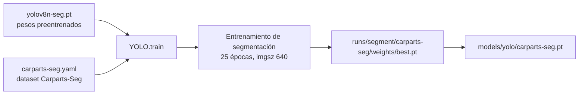
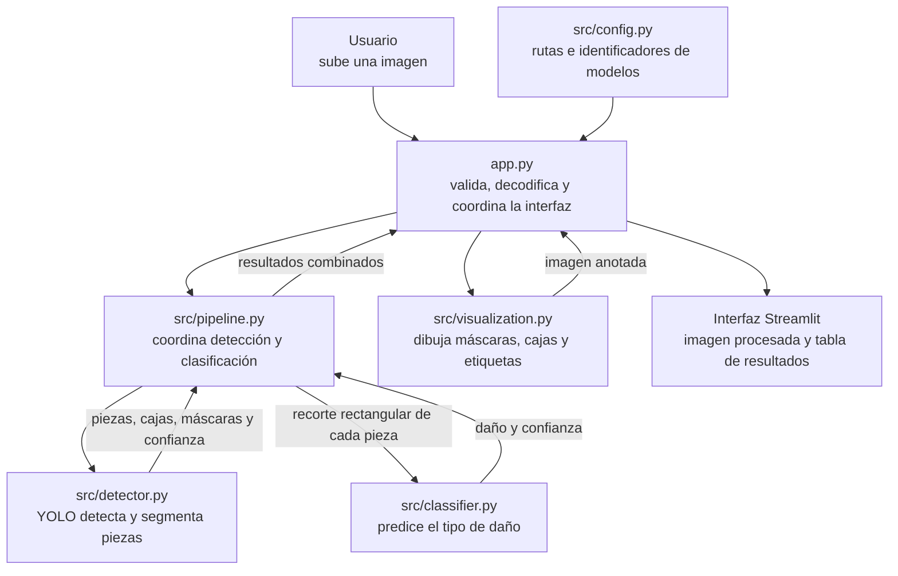
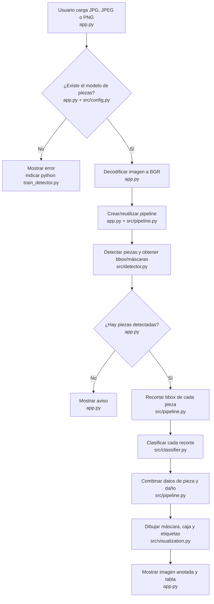

# Pipeline actual de la aplicación

Este documento describe lo que hace el código actualmente; no representa
funcionalidades futuras.

## 1. Preparación del modelo de piezas

Antes de analizar imágenes, debe existir el archivo
`models/yolo/carparts-seg.pt`.

El proceso está implementado en `train_detector.py`. Ultralytics obtiene el
dataset si no está disponible localmente. El script inicia un entrenamiento
nuevo con `yolov8n-seg.pt` durante 25 épocas; si se interrumpe, se puede
reanudar desde el último checkpoint con `python train_detector.py --resume`.
El mejor peso ya entrenado está disponible para la app en
`models/yolo/carparts-seg.pt`.

El clasificador no se entrena desde este proyecto: se descarga desde Hugging
Face la primera vez que se carga.

## 2. Análisis de una imagen en la app

### Relación entre archivos Python

Este es el recorrido normal al iniciar la app y analizar una imagen. Las
flechas indican llamadas o datos que pasan entre componentes:

`train_detector.py` no se ejecuta durante este recorrido: es una herramienta
separada para entrenar o reanudar el detector y generar
`models/yolo/carparts-seg.pt`. Los archivos `tests/*.py` tampoco forman parte
de la ejecución de la app; comprueban componentes del proyecto.

### Pasos del análisis

## 3. Qué calcula cada componente

1. **`app.py`** acepta una imagen, comprueba los pesos locales del detector,
   la decodifica y llama a `CarDamagePipeline.analyze`.
2. **`CarPartDetector` (`src/detector.py`)** carga los pesos de segmentación
   locales y devuelve, para cada detección:
   - `part`: nombre de la clase de pieza.
   - `confidence`: confianza de detección de la pieza.
   - `bbox`: coordenadas de la caja delimitadora.
   - `mask`: máscara de segmentación, si YOLO la devuelve.
3. **`CarDamagePipeline` (`src/pipeline.py`)** toma cada `bbox`, limita sus
   coordenadas a los bordes de la imagen y extrae ese rectángulo. Si una caja
   tiene coordenadas inválidas, genera un error.
4. **`DamageClassifier` (`src/classifier.py`)** procesa el recorte como RGB y
   predice una etiqueta y su confianza. Usa CUDA cuando está disponible; si
   no, usa CPU.
5. **`draw_detections` (`src/visualization.py`)** pinta la máscara (si existe),
   el rectángulo y las etiquetas de pieza y daño. La app muestra además una
   tabla con ambas confianzas.

El resultado combinado de cada pieza contiene `part`, `confidence`, `bbox`,
`mask`, `damage` y `damage_confidence`.

## 4. Límites del comportamiento actual

- La máscara se utiliza para visualizar la pieza, **pero no para recortar la
  entrada del clasificador**. El clasificador recibe el rectángulo `bbox`,
  incluyendo potencialmente fondo y otras partes.
- El clasificador solo tiene seis etiquetas: `Crack`, `Scratch`, `Tire Flat`,
  `Dent`, `Glass Shatter` y `Lamp Broken`. No existe una clase «sin daño»; por
  tanto, asigna alguna de esas etiquetas a cada pieza que recibe, aunque no
  haya daño visible.
- El flujo clasifica piezas; no combina predicciones para producir un
  diagnóstico global del vehículo.
- Los pesos YOLO usados por la app son el archivo local
  `models/yolo/carparts-seg.pt`; los pesos del clasificador y su procesador se
  obtienen del repositorio de Hugging Face.
